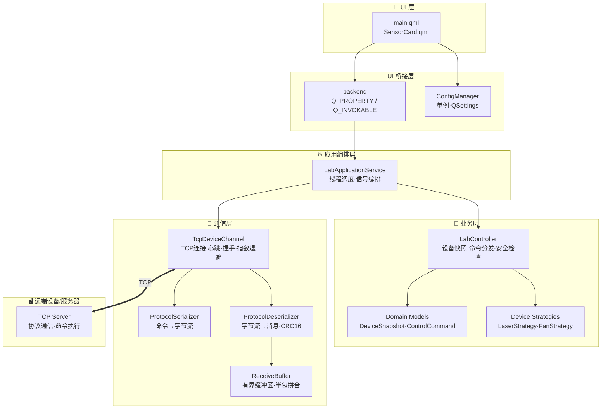
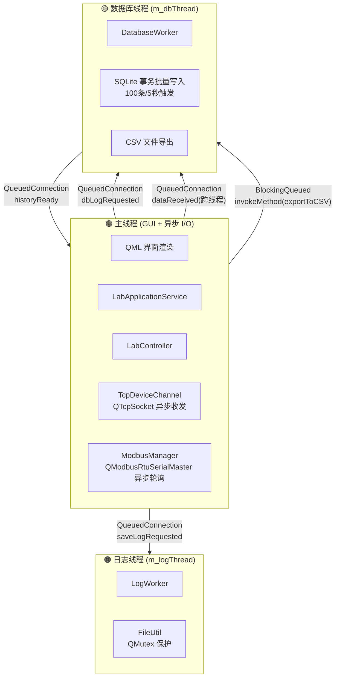
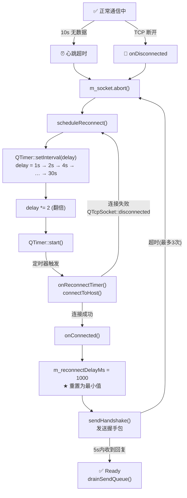

# Smart Lab Controller — 智能实验室自动化控制器

基于 Qt5/C++14 的实验室设备上位机监控系统。支持 **TCP 远程控制** + **Modbus RTU 串口多从站采集**双链路，实时监控激光功率、光源亮度、排风系统、温湿度传感器，具备弱网自愈、优先级任务队列、阈值告警硬件联动、事务批量落库能力。

---

## 目录

- [功能特性](#功能特性)
- [技术栈](#技术栈)
- [快速开始](#快速开始)
- [项目架构](#项目架构)
- [三层线程隔离架构](#三层线程隔离架构)
- [指数退避重连流程](#指数退避重连流程)
- [二进制协议](#二进制协议)
- [核心设计模式](#核心设计模式)
- [目录结构](#目录结构)
- [测试工具](#测试工具)

---

## 功能特性

| 模块 | 功能 |
|---|---|
| 设备控制 | 激光功率（0-200W）、光源亮度（0-100%）、排风开关、紧急停止 |
| Modbus 采集 | RS-485 多从站（温湿度计/风机/激光器）差异化轮询（1s/2s/3s），在线写入寄存器 |
| 状态监控 | 实时数值曲线（100ms 采样）、传感器趋势图（5分钟时间轴）、三色连接状态灯 |
| 通信协议 | 自定义二进制协议（TCP，魔数帧同步、CRC16 校验、握手、心跳）+ Modbus RTU |
| 弱网自愈 | 心跳超时检测、指数退避重连（1s→30s）、离线消息队列（256条上限） |
| 串口防护 | 优先级任务队列（写入插队）+ 状态机防半双工冲突 + 2s 回复超时看门狗 |
| 安全保护 | 温度阈值告警四联动（开排风/弹窗/日志/入库）、迟滞带防抖动、30s 冷却防刷屏 |
| 数据管理 | SQLite 事务批量落库（100条/5秒，吞吐提升约500倍）、CSV 导出 |
| 配置管理 | QSettings 持久化服务器 IP/端口/功率阈值/温度阈值，GUI 内直接修改 |

---

## 技术栈

| 层级 | 技术 |
|---|---|
| UI | Qt Quick (QML) + Qt Charts（LineSeries / DateTimeAxis） |
| C++ 标准 | C++14 |
| 构建 | CMake 3.5+ |
| 网络 | QTcpSocket（自定义二进制协议） |
| 串口 | QModbusRtuSerialMaster（Qt SerialBus，Modbus RTU 主站） |
| 数据库 | SQLite（Qt SQL 模块，事务 + execBatch 批量写入） |
| 配置持久化 | QSettings（INI 格式） |
| 测试服务器 | Python 3（`test_server.py` / `chaos_test_server.py`）+ 虚拟串口 + Modbus 从站模拟器 |

---

## 快速开始

### 环境要求

- Qt 5.12+（Core / Quick / Network / Sql / Charts）
- CMake 3.5+
- 支持 C++14 的编译器（MinGW 7.3+ / MSVC 2017+ / GCC 5+）
- Python 3（仅用于测试服务器）

### 编译

```bash
cd Smart_Lab_Controller
mkdir build && cd build
cmake ..
make -j$(nproc)      # Linux/macOS
# 或
mingw32-make -j4     # Windows MinGW
```

### 运行

```bash
# 启动测试服务器（终端1）
python test_server.py

# 启动客户端（终端2）
./Smart_Lab_Controller
```

---

## 项目架构

采用 **6 层分层架构**，每层只依赖下一层：



### 数据流方向

```text
【用户操作】QML 滑块拖动
  → backend::setLaserPower()            Q_PROPERTY WRITE
  → LabApplicationService               去重 + 编排
  → LabController::applyCommand()       策略分发
  → LaserStrategy::apply()              更新 DeviceSnapshot
  → ProtocolSerializer                   序列化为二进制包
  → TcpDeviceChannel::send()            TCP 发送
  → 远端设备

【远程指令】远端设备发来 Command
  → QTcpSocket::readyRead               触发信号
  → ProtocolDeserializer                字节→ProtocolMessage
  → LabController::processMessage()     解析命令
  → applyCommand(remote=true)           安全检查 + 阈值告警
  → emit snapshotChanged                向上冒泡
  → LabApplicationService               写数据库 + 转发
  → backend                             属性变更通知
  → QML 属性绑定自动刷新 UI
```

---

## 线程隔离架构

主线程不直接做任何**阻塞性** I/O——文件日志与数据库操作分散到 2 个专用 Worker 线程；TCP 与 Modbus 均为 Qt 事件驱动异步 I/O，在主线程事件循环中零阻塞运行：



### 线程隔离规则

| 规则 | 说明 |
|---|---|
| 主线程只做异步 I/O | TCP/Modbus 收发均为 Qt 事件驱动，`send()` 立即返回 |
| 阻塞操作入子线程 | 文件日志、SQLite 批量写入均在 Worker 线程 |
| 跨线程只用信号槽 | 主线程 emit 信号 → Qt 自动将 slot 投递到目标线程事件循环 |
| BlockingQueuedConnection | CSV 导出需要同步拿返回值，用此方式在 DB 线程执行后回传结果 |
| Worker moveToThread | LogWorker / DatabaseWorker 不继承 QThread，而是 moveToThread 到已有线程（注意：有 parent 的 QObject 不可 moveToThread） |

---

## 指数退避重连流程



### 为什么是指数退避？

| 固定间隔重连（❌） | 指数退避重连（✅） |
|---|---|
| 所有设备同时重连 → 网络风暴 | 各设备等待时间逐渐散开 |
| CPU 空转 busy-wait | QTimer sleep，CPU 休眠 |
| 服务器永远恢复不了 | 给服务器喘息时间 |

**退避区间**：`1000ms → 2000ms → 4000ms → 8000ms → 16000ms → 30000ms(上限)`

**离线消息队列**：离线期间控制命令进入 `QQueue<QByteArray>`（上限 256 条，满了丢弃最旧保留最新），恢复连接后 `drainSendQueue()` 批量发出。

---

## Modbus 多从站与优先级任务队列

### 多从站配置

```cpp
// 三个从站挂在同一条 RS-485 总线上，差异化轮询间隔
m_modbusManager->addSlave(ModbusSlaveConfig(1, "温湿度计", 0, 2, 2000));  // 2秒
m_modbusManager->addSlave(ModbusSlaveConfig(2, "风机控制器", 0, 1, 1000)); // 1秒
m_modbusManager->addSlave(ModbusSlaveConfig(3, "激光器",   2, 2, 3000));  // 3秒
```

### 为什么需要任务队列

Modbus RTU 是**半双工**总线：同一时刻串口上只能有一个请求在飞。轮询定时器与用户写入可能同时触发，直接并发调用 `sendXxxRequest` 会导致请求冲突。解决方案：

```text
所有请求 → enqueue() 入队 → 状态机串行发送
┌─────────────────────────────────────────────┐
│  m_highQueue    [写入任务]   ← 高优先级，自动插队 │
│  m_normalQueue  [轮询任务]   ← 普通优先级        │
│                                             │
│  processQueue():                            │
│    Idle 状态才取任务 → 发送 → WaitingReply     │
│    回复到达(或2s超时) → 回到 Idle → 取下一个    │
└─────────────────────────────────────────────┘
```

| 防护机制 | 实现 |
|---|---|
| 防并发 | `QueueState` 状态机（Idle/WaitingReply） |
| 写入优先 | 双队列：高优先级写入队列先出队 |
| 防卡死 | `m_replyTimeoutTimer` 2 秒超时强制解锁，跳过故障从站 |
| 防漂移 | 统一 200ms 检查定时器 + `m_lastPollTime` 记录各从站上次轮询时刻 |
| 读写区分 | `m_pendingTaskType` 记录在飞任务类型，写回复不误广播为传感器数据 |

### 指数退避重连（串口版）

串口链路同样实现了指数退避：意外断开 → 1s/2s/4s/8s/16s/30s 递增重连；用户主动断开（`m_autoReconnect=false`）不触发重连。连接成功即重置退避间隔。

---

## 事务批量落库

### 痛点

传感器每秒产生多条数据，逐条 `INSERT` 每条触发一次磁盘 fsync，10 条/秒 = 每秒 10 次磁盘同步。

### 方案：内存缓冲 + 双触发条件

```text
dataReceived → logSensorData()
  → m_buffer.append()           微秒级，纯内存
  → 触发条件1: 缓冲达到 100 条 → flushBuffer()
  → 触发条件2: 5 秒定时器到期  → flushBuffer()

flushBuffer():
  m_db.transaction()                    BEGIN
  query.execBatch()                     100 条 INSERT 一次执行
  m_db.commit()                         COMMIT（1 次 fsync）
```

| 指标 | 逐条 INSERT | 事务批量 |
|---|---|---|
| 100 条数据的 fsync 次数 | 100 次 | 1 次 |
| 100 条数据总耗时 | ~2-3 秒 | ~10-30 毫秒 |
| 吞吐提升 | 基准 | **约 500 倍** |

**代价与取舍**：进程崩溃时缓冲区（最多 99 条）会丢失——对监控场景可接受；正常退出时析构函数 `flushBuffer()` 兜底。

---

## 阈值告警与硬件联动

### 四级联动链路

```text
Modbus 温度 > 40℃（配置化阈值）
  ├─ ① 硬件联动: writeSingleRegister(2,0,1) 物理排风机启动
  │             setFanActive(true)          UI 状态同步
  ├─ ② UI 告警:  ModbussensorAlarm → QML 弹窗 + 背景闪红 + 三色灯变黄
  ├─ ③ 文件日志: [CRITICAL] 温度超阈值 41.3℃ > 40℃
  └─ ④ 数据库:   devise_Logs +1 (CRITICAL / sensor / temp_alarm / 41.3)
```

### 双防抖设计

| 机制 | 作用 |
|---|---|
| 迟滞带（40℃ 触发 / 35℃ 恢复） | 阈值边缘抖动（39.5-40.5 波动）不误报、不反复开关风机 |
| 30 秒冷却窗口（单发 QTimer） | 持续超温不刷屏，每 30 秒提醒一次"问题未解决" |

---

## 二进制协议

### 包格式（大端序）

```text
┌──────────┬─────────┬──────────┬──────────────┬────────┬──────────────┐
│  Magic   │ Version │  Type    │ Payload Len  │ CRC16  │   Payload    │
│  2 bytes │ 1 byte  │ 1 byte   │   4 bytes    │ 2 bytes│ 0~256 KB     │
│  0xABCD  │  0x01   │          │              │        │   (JSON)     │
└──────────┴─────────┴──────────┴──────────────┴────────┴──────────────┘
│←────────────────── 包头 10 bytes ──────────────────→│←── 载荷 ──→│
```

### 消息类型

| Type | 值 | 方向 | 说明 |
|---|---|---|---|
| Heartbeat | 1 | 双向 | 心跳保活，载荷含 `{"type":"heartbeat"}` |
| Command | 2 | 双向 | 控制指令，载荷含 `{"target":"laser","action":"set_power","value":150.5}` |
| Snapshot | 3 | 双向 | 设备状态快照，载荷含全部字段值 |
| Handshake | 4 | 双向 | 应用层握手，"你是不是合法设备？" |

### CRC16-CCITT 校验

- 查表法计算（256 项预计算表）
- 覆盖范围：`[type] [payloadLength(4B BE)] [payload]`
- 不覆盖 magic 和 version（这两项在 tryReadHeader 时已校验）

### 反序列化流程

```text
socket 收到字节
  → deserializer.append(bytes)         存入 ReceiveBuffer（上限 1MB）
  → takeMessages()                     循环提取
    ├─ tryReadHeader()                  peek 10字节，验 0xABCD + version=1
    ├─ canPeek(完整包)                  不够 → break（等下次 readyRead 拼包）
    ├─ peek(载荷)                       只读不取
    ├─ consume(完整包)                  数据有效，才真正移走
    ├─ validateCrc()                    CRC 不通过 → 丢弃该包
    └─ parseMessage()                   JSON → ProtocolMessage
```

---

## 核心设计模式

| 模式 | 应用位置 | 说明 |
|---|---|---|
| **分层架构** | 整个 `src/` 目录结构 | UI→桥接→编排→业务→通信，每层单向依赖 |
| **策略模式** | `IDeviceStrategy` / `LaserStrategy` / `FanStrategy` | 各设备独立处理命令，新增设备只需新增 strategy |
| **门面模式** | `backend` | 对 QML 隐藏内部调用链，暴露 4 个属性 + 7 个方法 |
| **命令模式** | `ControlCommand` | 本地操作和远程指令统一为命令对象 |
| **单例模式** | `ConfigManager` | C++11 Magic Statics 线程安全懒汉单例 |
| **依赖注入** | `LabController(std::function)` | Controller 不依赖 Transport，通过回调注入发送行为 |
| **Worker Thread** | `LogWorker` / `DatabaseWorker` | moveToThread，不继承 QThread |
| **优先级队列 + 状态机** | `ModbusManager` | 双队列（写高优/读普通）+ Idle/WaitingReply 防半双工冲突 |
| **事务批处理** | `DatabaseWorker::flushBuffer()` | 内存缓冲 100 条或 5 秒触发，transaction + execBatch |
| **迟滞控制** | 温度告警（40℃ 触发 / 35℃ 恢复） | 阈值带防边缘抖动，工业控制标准做法 |

---

## 目录结构

```text
Smart_Lab_Controller/
├── main.cpp                          # 程序入口，QML 上下文注入
├── CMakeLists.txt                    # CMake 构建配置 (Qt5, C++14)
│
├── main.qml                          # 主控制面板 UI
├── SensorCard.qml                    # 传感器卡片组件
├── qml.qrc                           # Qt 资源注册
├── fan.png                           # 风扇图标
│
├── backend.h / backend.cpp           # QML ↔ C++ 桥接层 (Q_PROPERTY / Q_INVOKABLE)
├── ConfigManager.h / .cpp            # 配置单例 (QSettings 持久化)
│
├── src/
│   ├── controller/
│   │   ├── labapplicationservice.h/cpp   # 应用编排中心（线程调度·信号连接）
│   │   └── labcontroller.h/cpp           # 设备控制核心（命令分发·安全检查）
│   │
│   ├── domain/
│   │   ├── models/
│   │   │   ├── devicesnapshot.h          # 设备状态快照 + ChangeFlags 变更检测
│   │   │   ├── controlcommand.h          # 控制命令 DTO
│   │   │   ├── telemetryframe.h          # 遥测帧 DTO
│   │   │   └── connectionstate.h         # 连接状态枚举
│   │   └── devices/
│   │       ├── idevicestrategy.h         # 设备策略接口
│   │       ├── laserstrategy.h           # 激光控制策略
│   │       └── fanstrategy.h             # 风扇控制策略
│   │
│   ├── infrastructure/transport/
│   │   ├── itransportchannel.h           # 传输通道接口
│   │   ├── transporttypes.h              # 传输层数据类型
│   │   └── tcpdevicechannel.h/cpp        # TCP 实现（心跳·握手·指数退避·发送队列）
│   │
│   └── protocol/
│       ├── protocolmessage.h             # 协议消息结构
│       ├── packetheader.h                # 包头定义 + CRC16 查表
│       ├── protocolserializer.h/cpp      # 序列化器（命令→二进制包）
│       ├── protocoldeserializer.h/cpp    # 反序列化器（二进制流→消息）
│       └── receivebuffer.h/cpp           # 有界接收缓冲区（1MB·惰性压缩·半包拼合）
│
│   └── Modbus/
│       ├── modbusmanager.h               # Modbus RTU 主站：多从站配置/任务结构定义
│       └── modbusmanager.cpp             # 优先级任务队列·状态机·指数退避·超时看门狗
│
├── logworker.h / logworker.cpp        # 异步日志 Worker
├── databaseworker.h / .cpp            # 异步数据库 Worker（SQLite + CSV导出）
├── FileUtil.h / FileUtil.cpp          # 文件工具（QMutex 保护的日志写入）
│
├── basedevice.h / basedevice.cpp      # [旧] 设备基类
├── FanDevice.h                        # [旧] 风扇设备类
├── LaserDevice.h                      # [旧] 激光设备类
│
├── test_server.py                     # 协议测试服务器
└── chaos_test_server.py               # 混沌故障模拟服务器（4种故障场景）
```

---

## 测试工具

### 标准测试服务器

```bash
python test_server.py [host] [port]
```

发送预设的激光功率和风扇控制指令，验证协议通信。

### 混沌故障模拟服务器

```bash
# 场景1: 随机断开
python chaos_test_server.py 127.0.0.1 8080 1

# 场景2: 假死模式（TCP保持但沉默）
python chaos_test_server.py 127.0.0.1 8080 2

# 场景3: 连接拒绝（模拟设备过载）
python chaos_test_server.py 127.0.0.1 8080 3

# 场景4: 间歇性抽风（混合所有故障）
python chaos_test_server.py 127.0.0.1 8080 4

# 不指定场景：自动随机切换
python chaos_test_server.py
```

观察客户端应对各种故障的行为：心跳超时检测、指数退避重连、离线队列缓存、恢复后批量排空。

---

## 许可证

MIT License

---

## 作者

大三暑期实训项目，用于学习 Qt/C++ 分层架构、多线程编程、工业通信协议设计与弱网自愈机制。
