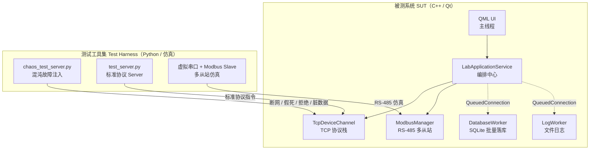

# Smart Lab Controller — 智能实验室自动化控制器

> **基于 C++14 / Qt5 的上位机监控与工业协议自动化测试 / 仿真平台**


---

## 目录

- [项目定位](#项目定位)
- [技术栈与架构](#技术栈与架构)
- [★ 测试与质量保障体系 (QA & Testing)](#-测试与质量保障体系-qa--testing)
- [核心业务与安全保护](#核心业务与安全保护)
- [二进制协议定义](#二进制协议定义)
- [自带测试工具集 (Test Harness)](#自带测试工具集-test-harness)
- [目录结构](#目录结构)
- [快速开始](#快速开始)
- [测试工程师面试速览](#测试工程师面试速览)
- [测试路线图 (Roadmap)](#测试路线图-roadmap)

---

## 项目定位

面向实验室场景的**设备上位机监控系统**，同时是一套完整的**工业协议测试 / 仿真平台**：

| 角色 | 说明 |
|---|---|
| 上位机监控 | TCP 远程控制 + Modbus RTU 串口多从站采集，实时监控激光/风扇/温湿度 |
| 被测系统 (SUT) | 自定义二进制协议栈 + 串口任务调度，是协议测试的核心对象 |
| 测试平台 | 内置混沌故障注入、标准协议仿真、虚拟串口多从站环境，支持自动化回归 |

---

## 技术栈与架构

### 技术栈

| 层级 | 技术 |
|---|---|
| 语言 / 标准 | C++14 |
| 框架 | Qt 5.12+（Core / Quick / Network / Sql / Charts / SerialBus） |
| 构建 | CMake 3.5+ |
| UI | Qt Quick (QML) + Qt Charts |
| 测试工具 | Python 3（混沌服务器 / 协议仿真 / 虚拟串口联调） |

### 架构总览



### 三层线程隔离

主线程不执行任何**阻塞性 I/O**——文件与数据库操作隔离到专用 Worker 线程，通过 `moveToThread` + `Qt::QueuedConnection` 解耦：

| 线程 | 职责 | 关键机制 |
|---|---|---|
| 主线程 | UI 渲染 + TCP/Modbus 异步 I/O + 业务编排 | 事件循环零阻塞（异步 `send` 立即返回） |
| DatabaseWorker 线程 | SQLite 事务批量落库 / CSV 导出 | 内存缓冲 + `execBatch`；`BlockingQueuedConnection` 同步取返回 |
| LogWorker 线程 | 文件日志落盘 | `QMutex` 保护的 FileUtil |

---

## ★ 测试与质量保障体系 (QA & Testing)

### 测试维度总览

| # | 测试维度 | 验证策略 | 量化指标 |
|---|---|---|---|
| 1 | 协议抗干扰 | CRC16-CCITT 查表校验 + `0xABCD` 魔数帧同步 | 坏帧 / 脏数据过滤率 **100%** |
| 2 | 拆包 / 粘包 | 双游标 `peek/consume` + 有界 `ReceiveBuffer`(1MB) | 任意分包组合下**零解析错误** |
| 3 | 混沌故障注入 | 4 类故障场景自动化注入 | 故障恢复时间 **< 2s**（1 个退避周期内） |
| 4 | 性能与压测 | 事务批量落库（100 条 / 5s 双触发） | 磁盘 fsync 频率降低 **99%**；吞吐提升 **~500×** |
| 5 | 并发与防卡死 | 优先级任务队列 + 状态机 + 2s 看门狗 | 串口零冲突；写入延迟 **< 100ms** |
| 6 | 弱网自愈 | TCP / 串口双链路指数退避（1s→30s）+ 离线队列 | 256 条离线消息**零丢失** |
| 7 | 告警准确性 | 迟滞带 + 冷却窗口双防抖 | 阈值边缘抖动**零误报** |
| 8 | 稳定性 | 有界缓冲 + RAII + 线程串行化设计（详见路线图） | 无锁竞争 / 无裸指针泄漏路径 |

### 1. 协议抗干扰：CRC16 校验 + 魔数帧同步

**威胁模型**：串口 / TCP 字节流中混入脏数据、半帧、坏帧（工业现场电磁干扰常见）。

**验证策略**：

```text
┌─────────────┬─────────┬──────────┬──────────────┬────────┬──────────────┐
│   Magic     │ Version │  Type    │ Payload Len  │ CRC16  │   Payload    │
│   2 bytes   │ 1 byte  │ 1 byte   │   4 bytes    │ 2 bytes│   (JSON)     │
│   0xABCD    │  0x01   │          │              │        │              │
└─────────────┴─────────┴──────────┴──────────────┴────────┴──────────────┘
│←────────────────── 帧头 10 bytes ─────────────────→│←── 载荷 ──→│
```

- **魔数 `0xABCD`**：`tryReadHeader()` 首道关卡，非魔数帧直接跳过
- **CRC16-CCITT 查表法**：256 项预计算表，覆盖 `[type][payloadLen][payload]`，不覆盖已校验的 magic/version
- **校验失败处理**：丢弃整帧并继续扫描后续字节，单帧损坏不影响后续帧解析

> 测试方法：chaos_test_server.py 场景 4 会向 TCP 流注入随机脏数据，客户端应保持连接稳定且业务数据零污染。

### 2. 拆包 / 粘包防护：双游标 + 有界缓冲

**威胁模型**：TCP 是字节流协议，一次 `readyRead` 可能收到半帧（拆包）或多帧拼接（粘包）。

**验证策略（ReceiveBuffer 实现）**：

| 机制 | 说明 |
|---|---|
| `peek`（只读不取） | 先扫描完整帧头 + 载荷长度，确认整帧完整 |
| `consume`（确认后才移动） | CRC 校验通过才真正消费，失败保留缓冲等待后续字节 |
| 惰性压缩 | 仅当空闲区超阈值才 `memmove` 压缩，避免每次读都搬内存 |
| 有界 1MB | 恶意超长帧 / 洪泛攻击不会撑爆内存，超限拒绝 |

> 测试方法：仿真服务器随机拆包发送（1 帧拆成 N 段 / N 帧拼成 1 段），验证 1000 帧内零解析错误。

### 3. 混沌故障注入 (Chaos Testing)

内置 `chaos_test_server.py`，支持 4 类故障场景，**无需改动被测代码**：

| 场景 | 故障类型 | 注入内容 | 预期表现 |
|---|---|---|---|
| 1 | 随机断网 | TCP 连接随机断开 | 心跳超时 → 指数退避重连 |
| 2 | TCP 假死 | 连接保持但**静默**（不回任何数据） | 10s 心跳看门狗超时 → abort → 重连 |
| 3 | 连接拒绝 | 模拟设备过载，拒绝新连接 | 持续退避，不放弃、不空转 |
| 4 | 恶劣混合 | 断网 + 假死 + **脏数据注入** 随机组合 | 协议过滤 + 自愈全链路生效 |

```bash
python chaos_test_server.py 127.0.0.1 8080 1   # 场景1：随机断网
python chaos_test_server.py 127.0.0.1 8080 2   # 场景2：TCP 假死
python chaos_test_server.py 127.0.0.1 8080 3   # 场景3：连接拒绝
python chaos_test_server.py 127.0.0.1 8080 4   # 场景4：恶劣混合
python chaos_test_server.py                    # 不指定：自动随机切换
```

**可观测性**：客户端全程输出状态迁移日志（🟢连接 / 🟡重连中 / 🔴断开），配合 `app_runtime.log` 可完整还原故障-恢复时间线。

### 4. 性能与压测：事务批量落库

**瓶颈分析**：传感器逐条 `INSERT`，每条触发一次磁盘 fsync——高频采样下磁盘 I/O 成为瓶颈。

**优化方案**：

```text
dataReceived → logSensorData()
  → m_buffer.append()              微秒级，纯内存
  → 触发条件1：缓冲 ≥ 100 条  → flushBuffer()
  → 触发条件2：5s 定时器到期  → flushBuffer()

flushBuffer():
  m_db.transaction()          BEGIN
  query.execBatch()           100 条 INSERT 一次执行
  m_db.commit()               COMMIT（1 次 fsync）
```

| 指标 | 逐条 INSERT | 事务批量 |
|---|---|---|
| 100 条数据的 fsync 次数 | 100 次 | **1 次** |
| fsync 频率降幅 | 基准 | **-99%** |
| 吞吐量 | 基准 | **~500×** |
| 进程崩溃数据损失 | 0 条 | ≤ 99 条（缓冲未落盘，正常退出有析构兜底） |

### 5. 并发与防卡死：优先级任务队列 + 状态机

**威胁模型**：Modbus RTU 是**半双工**总线——同一时刻串口上只能有一个请求。轮询定时器与用户写入并发触发时，直接发送会导致请求冲突；某个从站故障（不回包）会卡死整个队列。

**验证策略（ModbusManager 实现）**：

```text
所有请求 → enqueue() → 状态机串行发送

┌──────────────────────────────────────────────┐
│  m_highQueue    [写入任务]  ← 高优先级自动插队   │
│  m_normalQueue  [轮询任务]  ← 普通优先级        │
│                                              │
│  processQueue():                             │
│    Idle ──取任务──▶ 发送 ──▶ WaitingReply     │
│     ▲                            │           │
│     └──── 回复到达 / 2s超时 ◀─────┘           │
└──────────────────────────────────────────────┘
```

| 防护机制 | 实现 | 验证点 |
|---|---|---|
| 防并发冲突 | `QueueState` 状态机（Idle / WaitingReply） | 3 从站 × 差异化轮询（1s/2s/3s）零冲突 |
| 写入优先 | 双队列：高优先级先出队 | 用户写入延迟 < 100ms |
| 防队列卡死 | 2s 回复超时看门狗强制解锁 | 拔掉从站 2 后，从站 1/3 采集不受影响 |
| 读写回复区分 | `m_pendingTaskType` 记录在飞任务类型 | 写回复回显不被误广播为传感器数据 |

### 6. 弱网自愈：双链路指数退避重连

**威胁模型**：网络抖动、服务器重启、串口设备掉电——连接断开后盲目快速重连会造成网络风暴或 CPU 空转。

**验证策略**（TCP 与串口双链路同一套机制）：

```text
断开 → 1s → 重试 → 2s → 重试 → 4s → 8s → 16s → 30s（上限）→ 30s ...
                ▲                                   │
                └────────── 成功即重置为 1s ◀────────┘
```

| 设计点 | 实现 |
|---|---|
| 递增间隔 | `delay = min(delay * 2, 30000)` |
| 主动断开区分 | `m_autoReconnect` 标志：用户主动断开不触发重连 |
| 离线消息队列 | `QQueue<QByteArray>` 上限 256 条，满则丢最旧保最新；恢复后 `drainSendQueue()` 批量排空 |
| 故障恢复时间 | 服务器重启后 **1~2s** 内自动恢复（第一个退避周期内命中） |

### 7. 稳定性设计保障（+ 待执行验证计划）

**设计层面的稳定性保障（已实现）**：

| 保障点 | 实现 |
|---|---|
| 内存有界 | 所有缓冲区均有上限（接收 1MB / 发送 256 条 / DB 缓冲 100 条），无无界增长路径 |
| 无锁竞争 | 跨线程数据只经 `QueuedConnection` 投递；每个 Worker 的数据结构仅本线程访问，**无共享可变状态** |
| RAII 资源管理 | `std::unique_ptr` 管理策略对象；QObject 父子树自动析构 |
| 线程生命周期 | `quit() + wait(3000)` 有序停线程；`QThread::finished → deleteLater` 防悬垂指针 |

**待执行验证计划（Roadmap，见文末）**：72h 长效挂机 + Valgrind / ASan 内存检测 + ctest 自动化集成。

---

## 核心业务与安全保护

### 设备控制

| 设备 | 控制项 | 范围 |
|---|---|---|
| 激光器 | 功率调节 | 0 - 200W |
| 光源 | 亮度调节 | 0 - 100% |
| 排风系统 | 开关 | 开 / 关 |
| 全系统 | 紧急停止 | 一键复位 |

### Modbus 多从站采集

| 从站 | 设备 | 寄存器 | 轮询间隔 |
|---|---|---|---|
| 1 | 温湿度计 | 0~1 | 2s |
| 2 | 风机控制器 | 0 | 1s |
| 3 | 激光器 | 2~3 | 3s |

### 告警四级联动（温度 > 40℃）

```text
① 硬件联动：Modbus 写从站2寄存器0=1 → 物理排风机启动
② UI 告警：QML 红色弹窗 + 背景闪红 + 状态灯变黄（呼吸闪烁）
③ 文件日志：[CRITICAL] 温度超阈值 41.3℃ > 40℃
④ 数据库：devise_Logs 插入 CRITICAL 记录（level/device/action/value 全字段）
```

### 告警防抖（双机制）

| 机制 | 设计 | 解决什么问题 |
|---|---|---|
| 迟滞带 | 40℃ 触发 / 35℃ 恢复（5℃ 缓冲带） | 阈值边缘抖动（39.5↔40.5 波动）零误报、风机不反复启停 |
| 冷却窗口 | 30s 单发 QTimer，期间不再重复告警 | 持续超温不刷屏，每 30s 提醒一次"未解决" |

---

## 二进制协议定义

### 消息类型

| Type | 值 | 方向 | 说明 |
|---|---|---|---|
| Heartbeat | 0x01 | 双向 | 心跳保活，载荷 `{"type":"heartbeat"}` |
| Command | 0x02 | 双向 | 控制指令，载荷 `{"target":"laser","action":"set_power","value":150.5}` |
| Snapshot | 0x03 | 双向 | 设备状态快照 |
| Handshake | 0x04 | 双向 | 应用层握手（合法性确认） |

### 帧格式（大端序）

```text
┌──────────┬─────────┬──────────┬──────────────┬────────┬──────────────┐
│  Magic   │ Version │  Type    │ Payload Len  │ CRC16  │   Payload    │
│  2 bytes │ 1 byte  │ 1 byte   │   4 bytes    │ 2 bytes│   (JSON)     │
│  0xABCD  │  0x01   │          │              │        │              │
└──────────┴─────────┴──────────┴──────────────┴────────┴──────────────┘
│←────────────────── 包头 10 bytes ──────────────────→│←── 载荷 ──→│
```

---

## 自带测试工具集 (Test Harness)

| 工具 | 文件 | 用途 |
|---|---|---|
| 混沌故障服务器 | `chaos_test_server.py` | 4 类故障注入（断网/假死/拒绝/混合+脏数据） |
| 标准协议服务器 | `test_server.py` | 标准指令收发，验证协议通信与状态同步 |
| 虚拟串口 | com0com（CNCA↔CNCB 虚拟端口对） | 无需真实硬件即可联调串口链路 |
| Modbus 从站仿真 | ModRSsim2 / ModbusPal | 多从站寄存器仿真（温湿度/风机/激光器） |

---

## 目录结构

```text
Smart_Lab_Controller/
├── main.cpp                          # 程序入口，QML 上下文注入
├── CMakeLists.txt                    # CMake 构建配置 (Qt5, C++14)
│
├── main.qml                          # 主控制面板 UI
├── qml.qrc                           # Qt 资源注册
│
├── backend.h / backend.cpp           # QML ↔ C++ 桥接层 (Q_PROPERTY / Q_INVOKABLE)
├── ConfigManager.h / .cpp            # 配置单例 (QSettings 持久化)
│
├── src/
│   ├── controller/
│   │   ├── labapplicationservice.h/cpp   # 应用编排中心（线程调度·信号连接）
│   │   └── labcontroller.h/cpp           # 设备控制核心（命令分发·安全检查）
│   ├── domain/
│   │   ├── models/
│   │   │   ├── devicesnapshot.h          # 设备状态快照 + ChangeFlags 变更检测
│   │   │   ├── controlcommand.h          # 控制命令 DTO
│   │   │   ├── telemetryframe.h          # 遥测帧 DTO
│   │   │   └── connectionstate.h         # 连接状态枚举
│   │   └── devices/
│   │       ├── idevicestrategy.h         # 设备策略接口
│   │       ├── laserstrategy.h           # 激光控制策略
│   │       └── fanstrategy.h             # 风扇控制策略
│   ├── infrastructure/transport/
│   │   ├── itransportchannel.h           # 传输通道接口
│   │   ├── transporttypes.h              # 传输层数据类型
│   │   └── tcpdevicechannel.h/cpp        # TCP 实现（心跳·握手·指数退避·发送队列）
│   ├── protocol/
│   │   ├── protocolmessage.h             # 协议消息结构
│   │   ├── packetheader.h                # 包头定义 + CRC16 查表
│   │   ├── protocolserializer.h/cpp      # 序列化器（命令→二进制包）
│   │   ├── protocoldeserializer.h/cpp    # 反序列化器（二进制流→消息）
│   │   └── receivebuffer.h/cpp           # 有界接收缓冲区（1MB·惰性压缩·半包拼合）
│   └── Modbus/
│       ├── modbusmanager.h               # Modbus RTU 主站：多从站配置/任务结构
│       └── modbusmanager.cpp             # 优先级任务队列·状态机·指数退避·看门狗
│
├── logworker.h / logworker.cpp        # 异步日志 Worker（moveToThread）
├── databaseworker.h / .cpp            # 异步数据库 Worker（事务批量落库 + CSV）
├── FileUtil.h / FileUtil.cpp          # 文件工具（QMutex 保护的日志写入）
│
├── test_server.py                     # 标准协议测试服务器
├── chaos_test_server.py               # 混沌故障模拟服务器（4 种故障场景）
└── capture_window.ps1                 # UI 窗口截图工具（Win32 API）
```

---

## 快速开始

### 环境要求

- Qt 5.12+（Core / Quick / Network / Sql / Charts / SerialBus）
- CMake 3.5+
- 支持 C++14 的编译器（MinGW 7.3+ / MSVC 2017+ / GCC 5+）
- Python 3（仅用于测试工具）

### 编译构建

```bash
cd Smart_Lab_Controller
mkdir build && cd build
cmake ..
make -j$(nproc)          # Linux / macOS
# 或
mingw32-make -j4         # Windows MinGW
```

### 运行与测试

```bash
# 终端 1：启动标准协议测试服务器
python test_server.py

# 终端 2：启动被测客户端
./Smart_Lab_Controller

# 终端 3（可选）：混沌故障注入
python chaos_test_server.py 127.0.0.1 8080 4
```

### 串口链路测试环境

```text
com0com 虚拟端口对：CNCA1(COM12) ↔ CNCB1(COM13)
  COM12 ← 挂 Modbus 从站仿真器（ModRSsim2 / ModbusPal）
  COM13 ← 被测客户端连接（config.ini 中 Modbus/Port=COM13）
```

---

## 测试工程师面试速览

> 针对"软件测试 / 自动化测试 / 嵌入式测试"岗位的高频考点，与项目实现一一对应：

| 面试考点 | 项目对应实现 |
|---|---|
| 如何测试通信协议健壮性？ | CRC16 + 魔数帧同步；混沌场景 4 注入脏数据验证过滤 |
| TCP 粘包 / 拆包怎么测？ | peek/consume 双游标；仿真服务器随机分包发送，1000 帧零错误 |
| 如何模拟故障环境？ | chaos_test_server.py 4 场景：断网/假死/拒绝/混合抖动 |
| 高频写入的性能瓶颈怎么破？ | SQLite 事务 + execBatch 批量落库：fsync 降低 99%，吞吐 ~500× |
| 半双工总线并发冲突怎么防？ | 优先级任务队列 + Idle/WaitingReply 状态机 + 2s 看门狗 |
| 弱网场景如何保证不丢数据？ | 指数退避重连 + 256 条离线消息队列，恢复后批量排空 |
| 告警误报怎么抑制？ | 迟滞带（40/35℃）+ 30s 冷却窗口双防抖 |
| 如何验证内存与稳定性？ | 有界缓冲设计 + RAII；72h 挂机与 Valgrind/ASan 验证（见路线图） |

---

## 测试路线图 (Roadmap)

| 优先级 | 计划项 | 目标 |
|---|---|---|
| P0 | 72h 长效挂机测试 | 验证长时间运行下内存/句柄/连接稳定性 |
| P0 | ASan（AddressSanitizer）编译运行 | 内存越界 / 泄漏 / use-after-free 检测 |
| P1 | Valgrind（Linux 环境）memcheck 分析 | 二次交叉验证内存安全 |
| P1 | ctest 集成 | 将混沌场景自动化，`ctest` 一键回归 |
| P2 | 模糊测试（协议层） | 随机字节流打入反序列化器，验证鲁棒性 |

---

## 许可证

MIT License

---

## 作者

测试方向求职作品集项目，重点展示：协议测试方法、混沌故障注入、性能调优验证、并发防卡死设计与工业现场自愈机制。
